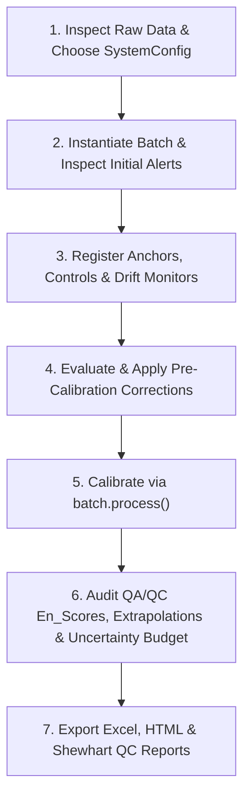

# `isotools` CF-IRMS Data Processing Skill

This skill guides AI agents through processing raw mass spectrometry sequences with **isotools** according to the *Principle of Identical Treatment* (Werner & Brand, 2001) and ISO/IEC 17025 metrology standards.



---

## Step-by-Step Standard Operating Procedure

### Step 1: Inspect Raw File & Select `SystemConfig`
Before loading the data into Python, examine the raw Excel file (`.xls` or `.xlsx`) to determine sheet names, column headers, and isotope system:

- **Nitrogen ($\delta^{15}\text{N}$):** Use `from isotools import NITROGEN`. Expects major beam `Ampl 28` / `Area 28` and `d 15N/14N`.
- **Water Hydrogen ($\delta^{2}\text{H}$):** Use `from isotools import WATER_H`. Expects major beam `Ampl 2` / `Area 2` and `d 2H/1H`.
- **Water Oxygen ($\delta^{18}\text{O}$):** Use `from isotools import WATER_O`. Expects major beam `Ampl 28` / `Area 28` and `d 18O/16O`.
- **Carbon ($\delta^{13}\text{C}$):** Use `from isotools import CARBON_13C`. Expects major beam `Ampl 44` / `Area 44` and `d 13C/12C`.

If the file contains custom column names, instantiate a custom `SystemConfig` (see `isotools/config.py`).

```python
from isotools import Batch, WATER_O

batch = Batch("my_sequence.xlsx", config=WATER_O, sheet_name="18O.wke")
```

---

### Step 2: Diagnostic Triage & Row Exclusions
`Batch` automatically validates headers and runs initial diagnostic checks upon loading:

```python
# Inspect all automated diagnostic flags
print(batch.alerts)
```

#### Diagnostic Evaluation Rules:
1. **Missing Sample Peaks:** Rows missing from the expected sequence indicate an autosampler drop failure.
2. **Double Drops / Abnormal Response:** In weighed runs, response factor $> 1.5\times$ run median indicates a double drop or weighing error. In unweighed runs (liquid water), peak area $< 0.5\times$ or $> 1.5\times$ run median indicates injection anomalies.
3. **Severe Signal Amplitude Drops:** Amplitudes $< 50\%$ of run median frequently indicate partial blockages or leaks.
4. **Replicate Flyers ($n \ge 3$):** Sample standard deviations $> 3 \times \sigma_{\text{method}}$ pinpoint specific flyer rows compared to the group median.

#### Applying Exclusions:
Never exclude data silently. Document the specific row number and physical reason:

```python
# Exclude specific corrupted rows
batch.exclude_rows([16, 22])

# For liquid water sequences, eliminate early carryover injections per vial
batch.exclude_first_injections(2)
```

---

### Step 3: Register Standards (Anchors, Controls, Monitors)
Standards must be registered using names or aliases found in `isotools.standards` (or custom `ReferenceMaterial` objects):

```python
# Anchors: Used to fit the calibration curve
batch.set_anchors(["Mar_O", "Buenos Aires_O", "Mendoza_O", "Antartida_O"])

# Controls: Used to check accuracy (trueness En score)
batch.set_controls(["USGS45_O", "USGS47_O"])

# Drift Monitors: Interspersed standard used to monitor instrumental drift
batch.set_drift_monitors(["Buenos Aires_O"])
```

If using a custom laboratory standard:
```python
from isotools import ReferenceMaterial, register_standard

lab_std = ReferenceMaterial(
    name="Lab-Water-1",
    d_true=-15.40,
    u_true=0.15,
    aliases=["lw1", "inhouse_1"],
    target_column="d18o",
)
register_standard(lab_std)
batch.set_anchors(["Lab-Water-1", "VSMOW2_O", "SLAP2_O"])
```

---

### Step 4: Evaluate & Apply Pre-Calibration Corrections
The CF-IRMS canonical order of operations (**Memory $\rightarrow$ Blank $\rightarrow$ Linearity $\rightarrow$ Drift**) is automatically enforced by `isotools`.

1. **Memory Carryover Correction (Gröning 2011):**
   ```python
   # Auto-estimate carryover coefficients or supply manual array
   batch.apply_memory_correction(coefficients=None, max_injections=3)
   ```
2. **Mass-Balance Blank Correction:**
   ```python
   # Blanks labeled 'blank' or 'bco cap'
   batch.apply_blank_correction(blank_identifier="blank")
   ```
3. **Linearity Dependence (Area / Amplitude):**
   ```python
   lin_stats = batch.check_linearity(substance_name="USGS35")
   print(lin_stats)
   # Only apply if slope is statistically significant (e.g. p < 0.05) or known from characterization
   if not lin_stats.empty and lin_stats.loc["USGS35", "p_value"] < 0.05:
       batch.apply_linearity_correction(substance_name="USGS35")
   ```
4. **Temporal Instrumental Drift:**
   ```python
   drift_stats = batch.check_drift()
   print(drift_stats)
   # Only apply if drift is statistically significant and R^2 indicates coherent drift
   if not drift_stats.empty and drift_stats.loc["Buenos Aires_O", "p_value"] < 0.05:
       batch.apply_drift_correction("Buenos Aires_O")
   ```

---

### Step 5: Normalize Scales & Calibrate Elemental Composition
Choose the appropriate calibration model:
- `SinglePointOffset()`: 1 anchor ($K = 1$). Assumes unit slope $m = 1$.
- `TwoPointLinear()`: 2 anchors ($K = 2$). Classic IAEA/IUPAC linear bracketing.
- `MultiPointLinear()`: 3 or more anchors ($K \ge 3$). Ordinary Least Squares with orthogonal excess lack-of-fit and inverse-regression leverage.

```python
from isotools import MultiPointLinear

# Execute calibration and uncertainty propagation
batch.process(strategy=MultiPointLinear(), use_method_precision=False)

# For solid EA-IRMS runs with sample weights (Amount)
# batch.calibrate_elemental_composition()

# Optional: Join field/sample metadata
# batch.join_metadata(metadata_dataframe, on="sample_name")
```

---

### Step 6: Metrological Verification & Audit
Always inspect the processed batch quality before exporting results:

```python
# 1. Trueness verification on Control standards (En <= 1.0)
print(batch.qaqc)
assert (batch.qaqc["En_Score"] <= 1.0).all(), "Quality control standard failed En <= 1.0!"

# 2. Check for post-normalization Scale Extrapolation alerts
extrap_alerts = batch.alerts[batch.alerts["reason"].str.contains("Scale Extrapolation")]
if not extrap_alerts.empty:
    print("Warning: Samples extrapolate beyond anchor calibration span:\n", extrap_alerts)

# 3. Uncertainty budget decomposition (% contribution to total variance)
print(batch.uncertainty_budget)
```

---

### Step 7: Export Client & Audit Reports
Export auditable Excel spreadsheets and interactive HTML dashboards:

```python
# Multi-sheet Excel export (Results, QAQC, Uncertainty_Budget, Parameters)
batch.save_report("Analysis_Results.xlsx")

# Standalone interactive Plotly HTML report
# Use offline=True for air-gapped lab workstations without internet access
batch.save_html_report("Analysis_Report.html", offline=True)

# For dual-isotope runs (e.g. 2H and 18O or 13C and 15N)
from isotools import generate_dual_isotope_html_report
generate_dual_isotope_html_report(
    batch_h,
    batch_o,
    "Dual_Isotope_Report.html",
    title="Hydrology Dual Isotope Analysis",
    offline=True,
)

# For long-term lab QA/QC tracking
from isotools import QualityControlLog
qc_log = QualityControlLog("lab_qc_history.csv")
qc_log.record_batch(batch)
qc_log.save_shewhart_html("USGS35", "USGS35_Shewhart.html", offline=True)
```

---

## Agent Guardrails & Best Practices

1. **Non-Destructive Integrity:** Never mutate raw columns in `batch.data` or `batch.replicates`. All corrections must proceed through standard `Batch` methods (`apply_blank_correction`, `apply_drift_correction`, etc.).
2. **Never Blindly Apply Corrections:** Always check `check_drift()` and `check_linearity()` before applying drift or linearity corrections. If $p \ge 0.05$ or $R^2 \approx 0$, applying a correction injects artificial noise rather than removing a physical trend.
3. **Use Unrounded Data for Downstream Math:** When computing custom metrics or passing data to external scientific libraries, use `batch.get_report(round_decimals=None)` and `batch.get_qaqc(round_decimals=None)` to avoid cumulative rounding errors.
4. **Mathematical Formatting in Summaries:** When reporting math formulas in Markdown artifacts, place display math `$$` on dedicated lines with blank lines above and below. Use `\text{...}` instead of `\mathrm{...}` for non-ASCII units (`\text{‰}`).
